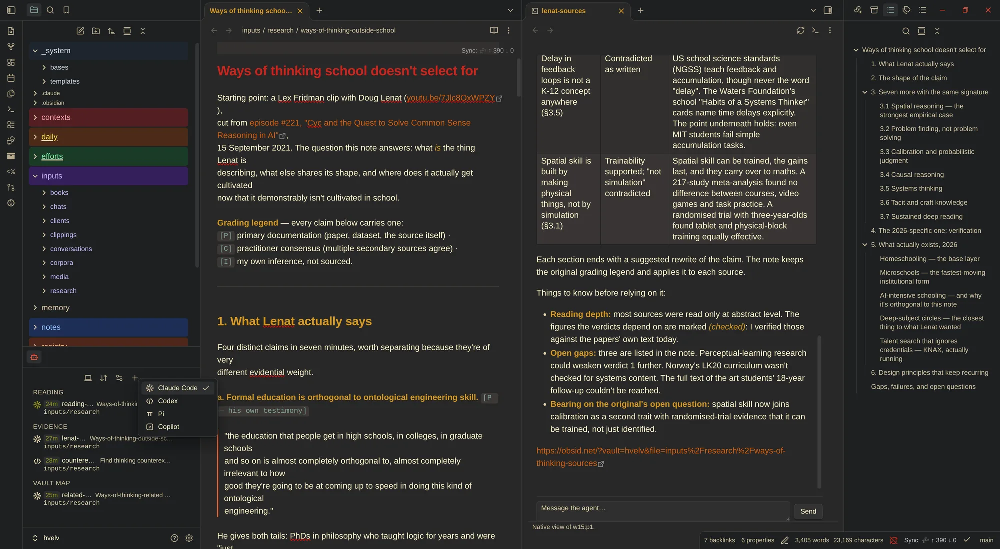

# Herdr for Obsidian

Your coding agents run persistently in [herdr](https://github.com/herdrdev/herdr)
or [herdr-core](https://github.com/herdrdev/herdr-core), which keep them alive
across sessions. This plugin brings the ones that belong to your vault into
Obsidian:



- **Agent list** in the sidebar: every agent of the matching herdr workspace, with
  its status, name, what it is doing, and its prompt-cache countdown. Sort by
  urgency or name, group by folder or by herdr tab. It updates live.
- **Native view**, the default: a Claude Code session rendered as Obsidian
  Markdown, with wikilinks, callouts and your theme, tool calls folded into one
  line per run, vault edits shown as links to the notes, a chat-style prompt box
  with `/` and `@` completion, and a table of contents where the outline lives.
  Made for knowledge work; the terminal is one click away on every tab.
  Available on herdr on this machine, on herdr-core here and over SSH (with
  the Claude session hook the plugin offers to install), and on Claude run
  by Obsidian. herdr over SSH shows the terminal only.
- **Terminals** as Obsidian tabs: open any agent's live terminal, type in it, or
  watch it read-only. Open it beside the note you are working on, or reuse one tab.
- **Notifications** when an agent stops and wants you, or finishes, with a status
  bar count.
- **Start agents from folders**: a hover button and a context-menu entry on any
  folder in the file explorer start an agent there, in the right herdr tab.
- **Runtimes**: a list of places your agents run, and you switch between them:
  the herdr TUI, herdr-core (`hc`, headless, with agents in Herdr UI's
  spaces), each on this machine or over SSH, and Claude Code run by Obsidian
  itself. The same list, actions and terminals on each, as long as a remote
  machine has a synced mirror of the vault.

Nothing here changes how herdr behaves for anyone using it outside Obsidian. All
the workspace filtering happens on the plugin side.

## Supported agent CLIs

The plugin starts and recognises every agent kind herdr can start: **Claude
Code**, **Codex**, **Gemini CLI**, **OpenCode**, **Pi**, **Cursor**, **Amp**,
**GitHub Copilot CLI**, **Kimi**, **Droid**, **Grok** and the rest of herdr's
list. The + button offers the ones installed on the active runtime's machine,
plus your own entries (a wrapper, extra arguments) from the settings, where
each CLI also says which of your machines it was found on. A mise or asdf
shim counts only when its tool is active in the vault folder; see
[docs/runtimes.md](docs/runtimes.md#starting-agents-the--button-and-the-agent-catalog).
Each has an icon in the list; a kind the plugin does not know yet gets a
neutral one. Anything herdr can attach to also shows up, whatever started it.

## Requirements

- Obsidian **desktop** 1.7.2 or newer. No mobile build.
- macOS or Linux.
- One runtime: **herdr 0.8.0 or newer, already running** (the plugin never
  starts, stops or updates a herdr server; it attaches to the one you have),
  **[herdr-core](https://github.com/herdrdev/herdr-core)** (`hc`), or
  **Claude Code** for the simple mode. See
  [Getting started](#getting-started).
- For a runtime over SSH: `ssh` on this machine, key-based login that does not
  prompt, and a copy of the vault on the remote host kept in sync by whatever you
  already use (Obsidian Sync, Self-hosted LiveSync, Syncthing, git). Leave the
  remote binary empty and the plugin finds herdr or `hc` on the remote host
  (its PATH, then Homebrew, `/usr/local/bin` and `~/.local/bin`).

## Install

Until the plugin is in the community list, install it with
[BRAT](https://github.com/TfTHacker/obsidian42-brat): add
`nytafar/obsidian-herdr` as a beta plugin, then enable **Herdr** under Community
plugins. Manual install works too: put `main.js`, `manifest.json` and
`styles.css` from a [release](https://github.com/nytafar/obsidian-herdr/releases)
into `<vault>/.obsidian/plugins/herdr/` and reload Obsidian.

Or let your coding agent do it. It installs Herdr and BRAT into your vault
from the release files ([docs/agent-install.md](docs/agent-install.md)):

```text
Install the Obsidian plugin Herdr for me: read
https://raw.githubusercontent.com/nytafar/obsidian-herdr/main/docs/agent-install.md
and follow it.
```

## Getting started

Nothing installed yet? Open the agent list (**Herdr: Show agents**). While no
runtime connects, it shows **Get started** in place of the list; the
**Herdr: Get started** command opens the same card at any time. It offers
three ways in:

1. **Start now with Claude, run by Obsidian.** If Claude Code is installed,
   one click adds the simple-mode runtime, makes it active and starts an
   agent at the vault root. No multiplexer needed; agents stop when Obsidian
   closes. If Claude Code is missing, the card links its setup guide and shows
   its official install command for you to run yourself.
2. **Install herdr-core**, the headless runtime that keeps agents running
   after Obsidian closes. The card shows its official install command,
   `curl -fsSL https://releases.herdr.dev/core/install.sh | sh` (on Windows,
   `irm https://releases.herdr.dev/core/install.ps1 | iex` in PowerShell), and
   offers to **Copy** it, **Run in a terminal tab** you watch and can stop
   with Ctrl-C (Linux for now: not on Windows, and not on macOS until it is
   verified there), or **Ask Claude** to run it. Claude always runs that
   session in the asking permission mode, whatever your runtime is set to, so
   the command waits on a permission card until you allow it, once: the card
   offers no "always allow" for it. When the
   install is done, **Check again** finds `hc`, and **Add herdr-core on this
   machine** adds the runtime, makes it active and offers the Claude session
   hook for the native view.
3. **Prefer the herdr terminal app?** A link to herdr's install docs.

**What the plugin downloads: nothing.** It never downloads, installs or
updates anything by itself. On request it shows herdr-core's official
installer and can run it, in a terminal tab you see or as a command Claude
asks you to allow; updates stay with `hc update`.

## Five-minute setup

1. Open **Settings → Herdr**. The status block at the top says which herdr binary
   was found, which socket answers, the server version, and which workspace
   matched your vault. Every setup problem shows up there first.
2. **Binary not found?** Obsidian launched from the Dock has no login `PATH`. Put
   the output of `which herdr` into **Herdr binary**. **Extra PATH entries** does
   the same for the tools your agents need.
3. **No workspace matched?** The plugin picks the herdr workspace whose label
   equals the vault folder name, else the one with the most panes inside the vault
   path. Label a workspace like your vault, or pin **Workspace ID**.
4. Run **Herdr: Show agents** from the command palette. The list opens in
   the left sidebar and stays wherever you drag it.

Only panes that run an agent are listed; plain shells stay invisible.

## Using it

**The list.** Each row is one agent: a kind icon coloured by status (orange
blocked, green done, blue working, faint idle), the agent's name, its current task
from the terminal title, a prompt-cache countdown while one is running, and its
folder. The toolbar at the top of the list switches runtime, sets sort (herdr's
own priority order, or alphabetical) and grouping (herdr tab, working directory,
or none), opens quick settings, and ends with the **+**. Clicking a row opens the
agent's terminal; the button that appears on hover jumps to the pane in the herdr
TUI. A setting swaps the two.

**The native view.** Clicking a Claude Code agent opens its session as
Markdown: the prose reads like a note, each turn's tool calls collapse into one
line, "Updated [[note]]" links to what the agent changed, and the prompt box
under the transcript sends or queues your next prompt. When the agent stops to
ask something, a card names the block and offers to open the terminal. The
header button on the tab switches to the terminal and back; each tab remembers
its choice. See [docs/native-view.md](docs/native-view.md).

**Terminals.** A terminal tab attaches to the agent's pane in one of two modes,
switchable with the eye button:

- **Control** (default): you type, you scroll, and the herdr pane follows the
  Obsidian tab's size while the tab is visible. herdr allows one controller per
  pane, so attaching takes over. A control tab left hidden for thirty seconds
  hands control back to herdr and takes it again when you return.
- **Observe**: read-only, never resizes, any number of watchers.

Shift+Enter inserts a line break in the agent's composer instead of submitting.
Scrolling moves the pane's own scrollback in herdr, so what you see is what the
TUI sees. Text selection works as usual; mouse clicks are not forwarded to the
agent yet.

By default a terminal opens beside the note when the note lies in the agent's
folder, otherwise as a tab; **Terminal placement** and **Terminal tab** change
that, including a mode that reuses one tab for whichever agent you pick.
Colours follow Obsidian or one of eight built-in palettes. Two terminal engines
are available; see [docs/settings.md](docs/settings.md) for when to switch.

**Starting agents.** Hover a folder in the file explorer for the herdr button, or
right-click it: **Start agent here** creates the pane and starts the runtime's
default agent, named from the pattern in settings. The **+** at the far right
of the agent list's toolbar does the same at the vault root on a left click;
a right click lists every agent CLI installed on the runtime's machine. A second agent in the same
folder splits that folder's herdr tab rather than opening another, up to a cap;
turn **Share a herdr tab** off to give every agent its own tab, the way herdr is
navigated. The same actions are in the command palette for the active note's
folder.

**Notifications.** Only two transitions interrupt you: an agent becoming
**blocked** (it wants you) and becoming **done**. Each can raise an in-app notice
and, while Obsidian is unfocused, a system notification. A pane whose terminal
you have open never notifies. Focusing the pane in herdr is what marks it seen.

## Settings, runtimes, troubleshooting

- [docs/native-view.md](docs/native-view.md), the native view: what it shows,
  the prompt box, the waiting card, and its limits.
- [docs/settings.md](docs/settings.md), every setting on one line, with units.
- [docs/runtimes.md](docs/runtimes.md), adding and switching runtimes, herdr
  over SSH with the vault mirror it needs and its two caveats, and herdr-core.
- [docs/troubleshooting.md](docs/troubleshooting.md), the messages you may see
  and what they mean.
- [docs/architecture.md](docs/architecture.md), how the plugin talks to herdr and
  what that seam can and cannot do.
- [docs/development.md](docs/development.md), building, testing and installing
  into a vault without hanging it.

## License

MIT. See `LICENSE`.
